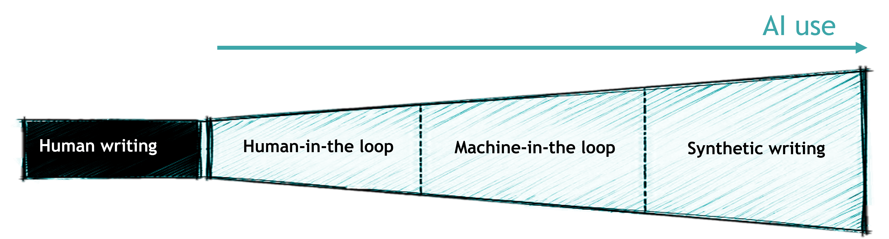

# AI use in the writing process

p.s.: This activity is happening outside the coputer, with prints and post-its for interaction with participants.

1. Print the image bellow or just the words of each part for the interaction.

2. Give 5 post-its for each student

3. Ask them to write one research activity in each post-it and place it in what level of AI usage they would asign this task.

- It can be from the perspective of what they already do

- It can be the perspective of what they consider a fine application of AI

4. Read the answers and discuss some aspects, concerns, and possible consequences/challenges of this.